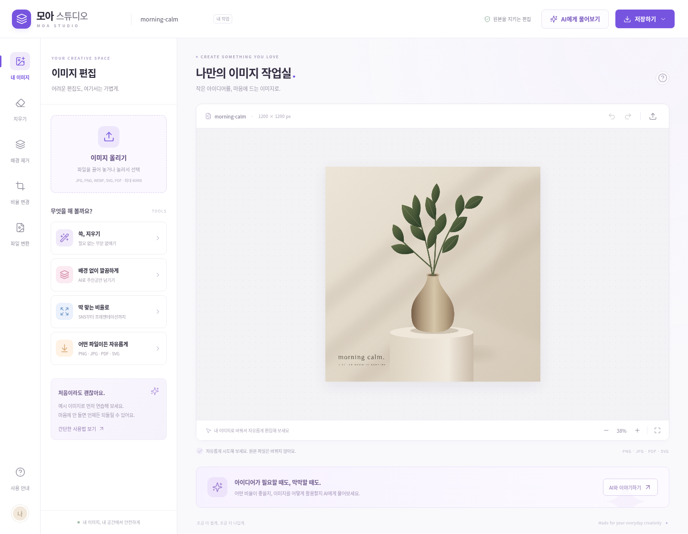
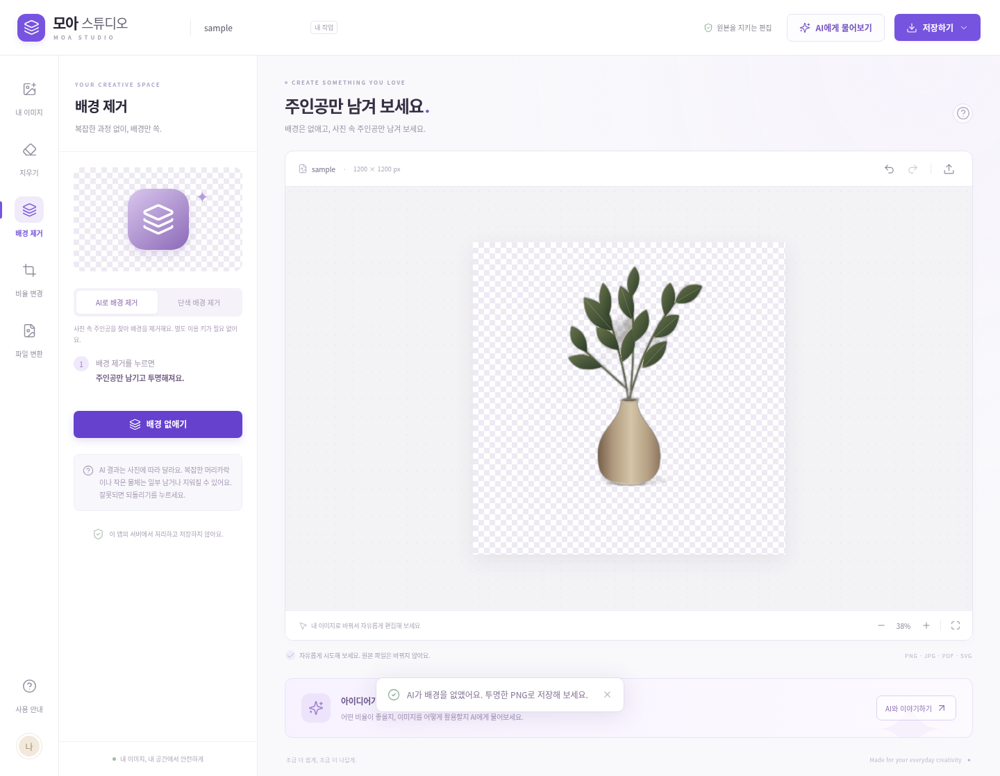

# 검증 결과

현재 클라우드에서 실제로 실행한 결과입니다. 외부 배포나 새 클라우드 작업에서의 복원을 검증한 결과는 아닙니다.

- `npm ci`: 고정된 잠금 파일로 재설치 성공.
- `bash scripts/setup-image-tools.sh`: 반복 실행 성공. 고정 Python 의존성과 공식 체크섬으로 검증한 u2netp 모델 준비.
- `npm run build`: TypeScript 검사와 배포용 빌드 통과.
- `npm test`: 이미지 엔진 9개, 서버 API 7개, 총 16개 통과.
- `TEST_BASE_URL=http://127.0.0.1:3001 npm run test:e2e`: 배포용 서버를 실제 Chromium에서 실행하여 아래 검사 모두 통과.

브라우저 검사는 예시 이미지 표시, 이미지 업로드, 선택 영역의 픽셀 삭제, 정확한 되돌리기·다시 실행, 단색 배경 투명도 유지, 실제 OpenCV 서버 지우기, 실제 AI 모델의 배경 분리, 비율 변경과 크기 되돌리기, 2배 확대된 PNG/JPG/PDF/SVG 저장과 다시 열기, 네 가지 입력·출력의 16가지 조합, 여러 쪽 PDF의 이전·다음 쪽 선택, AI 미연결 안내, 모바일 가로 넘침과 저장 창을 확인했습니다. 브라우저에서 처리되지 않은 예외는 없었습니다.

AI 배경 제거 예시에서는 전체 1,440,000픽셀 가운데 1,261,233픽셀이 거의 투명해지고, 주인공의 110,969픽셀이 불투명하게 유지되는 실제 모델 출력을 관찰했습니다. 모든 사진에서 동일한 품질을 보장하는 의미는 아닙니다.

- 실제 `/api/health`: 앱 정상, 배경 제거 AI 준비됨, OpenCV 지우기 준비됨, AI 대화 키는 미설정.
- 실제 OpenAI AI 대화: **미검증**. 키가 없어 호출하지 않았습니다. 모의 응답으로 서버 요청·응답·오류 처리를 검사한 결과와 구분합니다.
- `npm audit --omit=dev`: 배포용 JavaScript 의존성에서 알려진 취약점 0개. PDF 도구를 수정된 버전으로 설치하고 새 버전으로 배포용 브라우저 검사까지 통과했습니다.
- Canva 내부 구조: **미확인**. 네트워크 접근 제한과 초기 브라우저 이동 실패로 조사하지 못했습니다. 앱은 독립 구현입니다.

## v2: 주변 환경에 맞추기

주변의 정상 무늬를 찾아 선택 영역에 이어 넣는 브라우저 전용 복원 모드를 추가했습니다. 단독 HTML에도 작업 코드를 포함해 서버 없이 작동합니다. 별도 스레드에서 실행해 화면을 멈추지 않고, 선택 바깥 픽셀은 유지합니다.

추가 단위 검사 4개가 통과했습니다. 반복 줄무늬 복원이 단순 색상 혼합보다 오차가 낮은지, 선택 바깥 픽셀과 원본이 유지되는지, 빈 영역 선택과 잘못된 입력을 올바르게 처리하는지 검사했습니다. 실제 HTML 브라우저 검사에서도 줄무늬 위의 빨간 물체를 지운 뒤 원래 줄무늬가 이어졌고, 생성한 시험 이미지의 선택 영역 평균 채널 오차는 0이었습니다. 되돌리기·다시 실행·PNG 저장과 외부 요청 없는 동작도 확인했습니다. 이 시험 결과가 복잡한 실제 사진의 완벽한 복원을 보장하지는 않습니다.

클라우드 브라우저 정책이 `file://` 이동을 차단하므로, 자동 검사는 실제 HTML 파일 바이트를 브라우저 문서에 로드해서 수행했습니다. 사용자 PC의 더블클릭 실행과 오른쪽 미리보기 UI를 확인한 결과와는 구분합니다.
